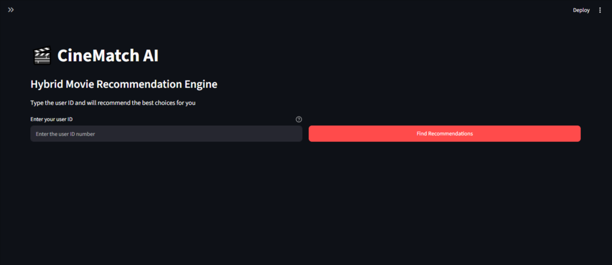
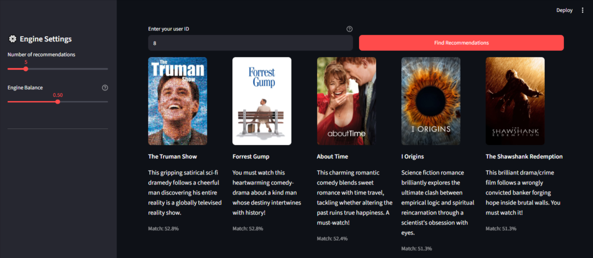

# CineMatch 🎬

**CineMatch** is an interactive movie recommendation application built with Streamlit. It combines user rating patterns, metadata content matching, visual poster artwork, and AI-generated plot summaries to deliver personalized movie suggestions.

---

## ✨Key Features

* **Hybrid Recommendation Engine:** Combines collaborative filtering (SVD) with content-based filtering (cosine similarity) for tailored suggestions.
* **Interactive Engine Slider:** Adjust the recommendation balance in real time—shift weight toward movie metadata features or user rating behavior.
* **Visual Poster Integration:** Dynamic poster image retrieval for recommended movies using the TMDB API.
* **AI Movie Summaries:** AI-generated 20-word plot summaries using Google's Gemini API (`gemini-3.5-flash-lite`).

---

## 📂Project Structure

```
text
├── app.py                 # Streamlit application UI and visual workflow
├── engine.py              # Hybrid recommendation model logic
├── content.py             # Google Gemini API integration for movie summaries
├── poster.py              # TMDB API client for image fetching
├── Notebooks/             # Jupyter notebooks for EDA, model training & testing
│   └── editor.ipynb
├── Data/                  # Pre-trained models and dataset artifacts
│   ├── Movies_Data.pkl
│   ├── User_data.pkl
│   ├── Model_SVD.pkl
│   └── Similarity.pkl
├── Assets/                # Screenshots and visual assets
│   ├── Home.png
│   └── Recommendations.png
└── .streamlit/
    └── secrets.toml       # API keys configuration
```

---

## 📸Screenshots

**🏠Home**
<p align="center">
    
</p>

**🔥Recommendations**
<p align="center">
     
</p>

---


## 🛠️Prerequisites

* Python 
* TMDB API Key
* Google Gemini API Key
* pandas
* numpy
* ast
* nltk.stem.porter
* sklearn.feature_extraction.text
* sklearn.metrics.pairwise
* joblib
* surprise
* sklearn.preprocessing
* scipy.sparse
* streamlit
* requests
* requests.adapters
* urllib3.util.retry

---

## 🚀Installation & Setup

* **Clone the Repository**
```
git clone https://github.com/s-jandali/cinematch.git
```

* **Install Dependencies**
```
pip install -r requirements.txt
```

* **Configure API Credentials:**
create a .streamlit/secrets.toml file in the root directory.
```  
GEMINI_API_KEY = "your_gemini_api_key"
TMDB_API_KEY = "your_tmdb_api_key"
```

* **Running the Application**
```
streamlit -m run app.py
```

---


## 👨‍💻 Developer

GitHub: https://github.com/s-jandali

---

## ⚖️ License

This project is licensed under the [MIT License](LICENSE) - see the file for details.
